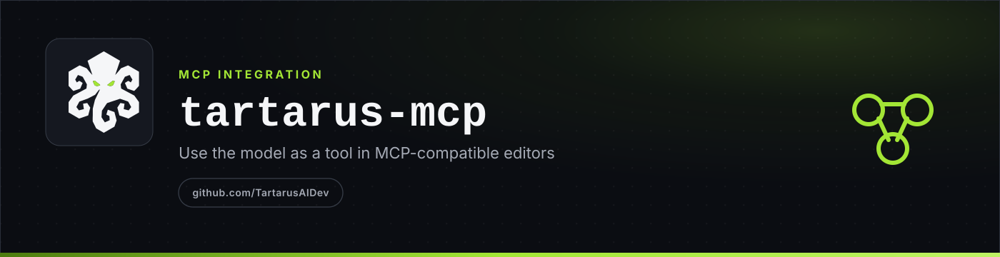

<p align="center">
  <a href="https://tartarusai.dev/?utm_source=github&utm_medium=readme&utm_campaign=tartarus-mcp&utm_content=banner">
    
  </a>
</p>

# tartarus-mcp

**An uncensored coding model as a [Model Context Protocol](https://modelcontextprotocol.io) tool.**

[](https://www.npmjs.com/package/tartarus-mcp)
[](LICENSE)

Drop [Tartarus](https://tartarusai.dev/?utm_source=github&utm_medium=readme&utm_campaign=tartarus-mcp&utm_content=body) into any MCP client (Claude Desktop,
Cursor, Cline, Zed, Continue) as a tool. When your main assistant hits a refusal
or needs code it won't write, it can hand the task to the `tartarus_code` tool
and get an answer back.

## Install

No install needed with `npx`. Add this to your MCP client config:

```json
{
  "mcpServers": {
    "tartarus": {
      "command": "npx",
      "args": ["-y", "tartarus-mcp"],
      "env": { "TARTARUS_TOKEN": "your-token-from-dash.tartarusai.dev" }
    }
  }
}
```

- **Claude Desktop** — `claude_desktop_config.json`
- **Cursor** — `~/.cursor/mcp.json`
- **Cline / Continue / Zed** — their `mcp` settings block

Restart the client; a `tartarus_code` tool appears.

## Tool

| Tool | Args | Returns |
|---|---|---|
| `tartarus_code` | `prompt` (string), `system` (string, optional) | the model's completion as text |

## Config

| Env var | Default |
|---|---|
| `TARTARUS_TOKEN` | *(required)* |
| `TARTARUS_MODEL` | `tartarus-coder` |
| `TARTARUS_BASE_URL` | `https://api.tartarusai.dev/v1` |

## From source

```bash
npm install
npm run build
TARTARUS_TOKEN=... npm start
```

## License

MIT. Built by [Tartarus AI](https://tartarusai.dev/?utm_source=github&utm_medium=readme&utm_campaign=tartarus-mcp&utm_content=body).
